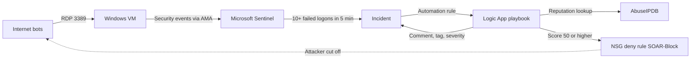
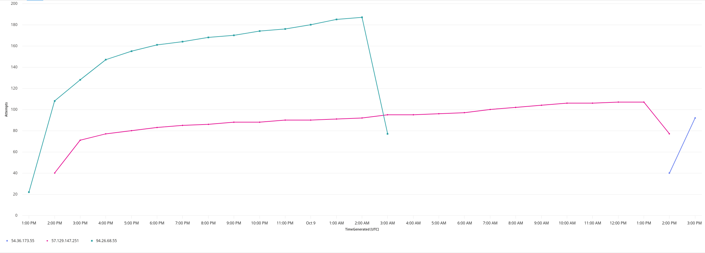
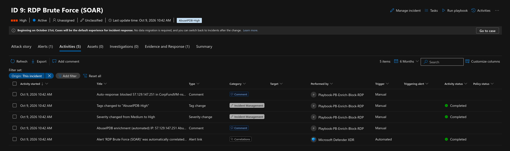
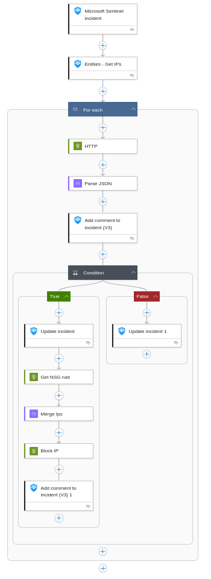
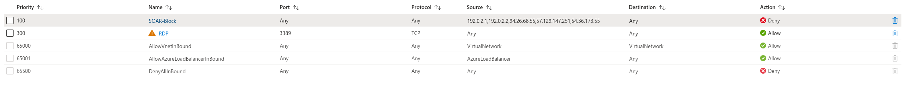
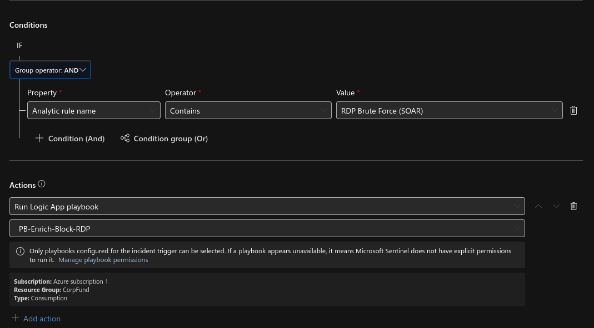

# Sentinel SOAR Lab: Automated RDP Brute-Force Response

An exposed Windows VM, Microsoft Sentinel and an Azure Logic App that **detect, investigate and block** RDP brute-force attackers with no human in the loop.

Attackers were triaged in **8–18 seconds** (average about 12) instead of the 10–15 minutes a manual analyst workflow takes, and **every auto-blocked IP made zero further attempts.**

> Follow-up to my [SOC Homelab](https://github.com/NotKornFlakes/SocHomelab) honeypot study. That project watched attackers; this one responds to them.

---

## How it works



1. **Bait:** a Windows 10 VM with RDP open to the internet and the host firewall off.
2. **Detect:** a Sentinel scheduled rule fires on 10 or more failed logons (Event 4625) from one IP in 5 minutes. Incidents are grouped per attacker IP over 24 hours.
3. **Investigate:** an automation rule runs the Logic App, which looks the IP up in **AbuseIPDB** and writes the score, ISP, usage type, country and report count onto the incident.
4. **Decide:** a score of **50 or higher** raises the incident to **High** and tags it `AbuseIPDB-High`. Anything lower is tagged `AbuseIPDB-Low` for a human to review.
5. **Respond:** High-confidence IPs are appended to an NSG **Deny** rule (priority 100) through the Azure REST API, using the playbook's managed identity. No secrets are stored in the workflow.

---

## Results (Oct 7–10, 2026)

| Metric | Value |
|---|---|
| Failed RDP logons captured | **56,885** from **142** unique IPs (about 62 hours) |
| Incidents created | **13** |
| Incidents enriched by the playbook | **9** (7 fully automatic, 2 manual tests) |
| Scored High → auto-blocked at the NSG | **3** |
| Scored Low → tagged for review | **5** |
| Time to triage (automated incidents measured) | **8–18 seconds**, average about 12 |
| Attempts from blocked IPs after their block | **0** |
| Alert-to-incident noise reduction | 65 alerts → 6 incidents (**~91%**) during the first night |
| Successful attacker logons | **0** |
| Cost | about **$20** |

### Auto-blocked attackers

| Incident | Attacker IP | Total attempts | Triage time | Last attempt |
|---|---|---|---|---|
| #7 | 94.26.68.55 | 930 | 8 s | 5 s after incident creation |
| #9 | 57.129.147.251 | 1,618 | 14 s | 15 s after incident creation |
| #10 | 54.36.173.55 | 132 | 18 s | 16 s after incident creation (blocked 11 min after its first attempt) |

*A fourth IP, 80.66.83.43, was added to SOAR-Block during a manual playbook test on an older incident and is not counted above.*



---

## Findings

### 1. Low-and-slow attackers slipped under the threshold
**57.129.147.251** attacked for **about 16 hours before triggering an incident.** It held a steady 80–107 attempts an hour (7–9 per 5 minutes), just under the 10-per-5-minutes threshold.

**Fix:** a second rule, [`rdp-low-and-slow-soar.kql`](detections/rdp-low-and-slow-soar.kql), for 50 or more failures per hour. It would have caught this IP in its first hour.

### 2. Reputation alone misses new attackers
**5 of the 8 enriched attackers scored under 50** on AbuseIPDB, so they weren't blocked, even though every one of them was actively brute-forcing the VM. Reputation feeds lag behind new infrastructure.

**Fix:** add a behavioural block alongside the reputation one, for example blocking any IP with 500 or more failures whatever its score, or reporting attackers back to AbuseIPDB so the feed improves.

### 3. Grouping matters as much as detection
Without 24-hour per-IP grouping, the first night would have produced **65 separate incidents** (and 65 playbook runs and API calls) instead of 6.

---

## Repository layout

```
detections/   Sentinel analytics rules (KQL)
playbook/     Sanitized Logic App export and deployment notes
queries/      Hunting, validation and metrics queries
screenshots/  Evidence (sensitive identifiers cropped)
```

| File | Purpose |
|---|---|
| `detections/rdp-bruteforce-soar.kql` | Main detection: 10+ failures in 5 min |
| `detections/rdp-low-and-slow-soar.kql` | Tuning added after Finding 1 |
| `playbook/pb-enrich-block-rdp.json` | Logic App definition (key and subscription ID removed) |
| `queries/01-health-check.kql` | Compromise check (new accounts, group changes, log clearing) |
| `queries/03-blocked-ip-timechart.kql` | Before/after chart for blocked IPs |
| `queries/05-triage-speed.kql` | Time from incident to automated triage |
| `queries/08-detection-coverage.kql` | Share of attackers the rules caught |

---

## Screenshots

| | |
|---|---|
|  |  |
| Incident with AbuseIPDB comment, High tag and auto-block comment | Playbook flow |
|  |  |
| NSG deny rule populated by the playbook | Sentinel automation rule |

---

## Stack
Microsoft Sentinel · Microsoft Defender portal · Log Analytics (KQL) · Azure Monitor Agent / DCR · Azure Logic Apps (Consumption) · Managed identity / Azure RBAC · Azure REST API · Network Security Groups · AbuseIPDB API · MITRE ATT&CK T1110

## Safety notes
- The API key was stored as a **SecureString** parameter and removed from the export. The subscription ID is replaced with `<SUBSCRIPTION-ID>`.
- The home IP is excluded from detection, so the playbook can never block the admin.
- The playbook's identity has only **Sentinel Responder** and **Network Contributor** on the lab resource group (least privilege).
- All resources were deleted after the test.

---

*Built by Tim · [Medium](https://medium.com/@no1listeninghere) · [GitHub](https://github.com/NotKornFlakes)*
